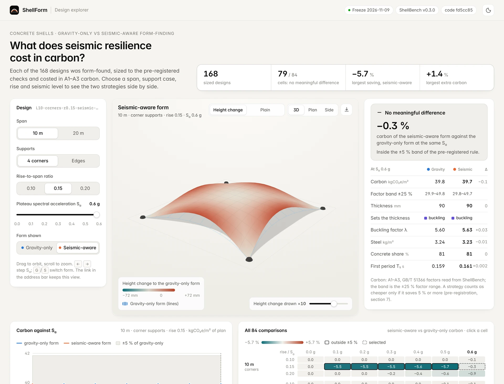
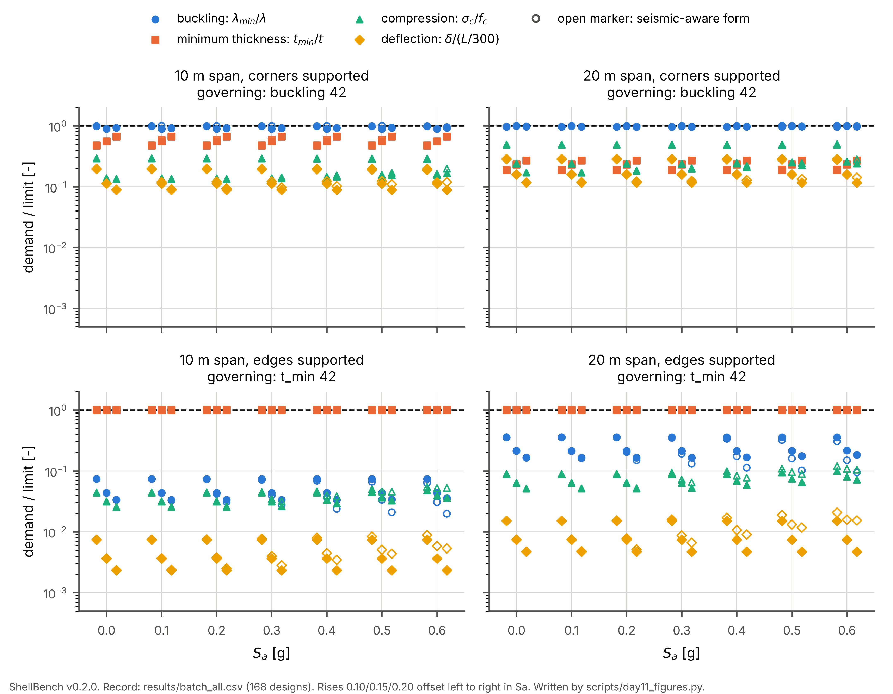
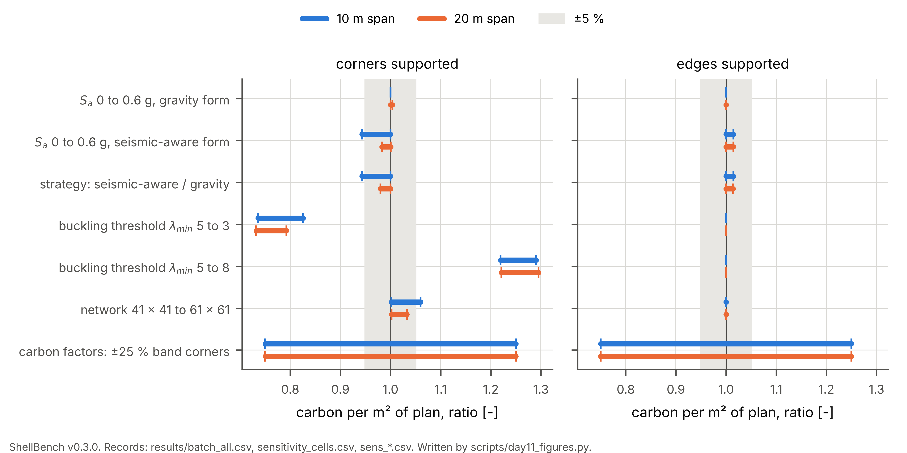
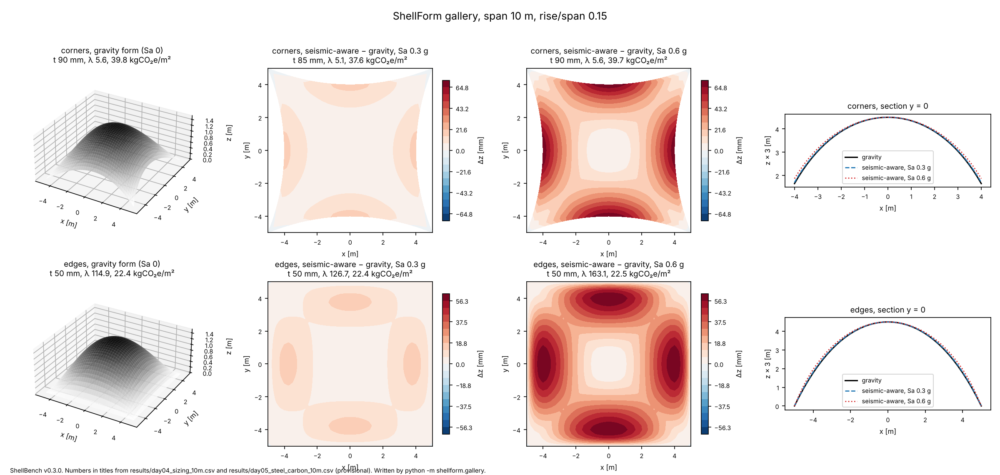

<h1 align="center">ShellForm</h1>

<p align="center"><b>The carbon cost of seismic resilience</b><br>
Gravity-only versus seismic-aware form-finding of concrete shells: 168 sized designs, their A1-A3 carbon, and an interactive explorer.</p>

<p align="center">
<a href="explorer/index.html">Design explorer</a> ·
<a href="figures/README.md">Figures</a> ·
<a href="docs/preregistration.md">Pre-registration</a> ·
<a href="paper/numbers.md">Numbers and sources</a> ·
<a href="CITATION.cff">Cite</a>
</p>

<picture>
  <source media="(prefers-color-scheme: dark)" srcset="docs/img/explorer_dark.webp">
  
</picture>

How much embodied carbon does seismic resilience cost in a form-found concrete shell, and does form-finding that includes seismic loads deliver it more cheaply than thickening a gravity-only shape?

ShellForm extends the seismic form-finding of Michiels & Adriaenssens (2017, 2018) by sizing each form to pass code checks and counting its A1-A3 embodied carbon. It is built on the validated, tagged modules of [ShellBench](https://github.com/syednafizreja/ShellBench) and never copies a ShellBench value (see [docs/data_contract.md](docs/data_contract.md)).

## At a glance

| | |
|---|---|
| **Question** | Does seismic-aware form-finding save carbon against a gravity-only form sized for the same seismic level? |
| **Design space** | 2 spans × 2 support cases × 3 rises × 2 strategies × 7 Sa levels = 168 sized designs |
| **Decision rule** | Pre-registered: a strategy is cheaper only if it saves 5 % or more ([section 7](docs/preregistration.md)) |
| **Result (freeze run)** | 79 of 84 cells: no meaningful difference. Details under [Main result](#main-result-freeze-run-9-nov-2026). |
| **Record** | Code tag `freeze-2026-11-09`, ShellBench `v0.3.0`; every number traces to `results/` |

## Explore

Open [`explorer/index.html`](explorer/index.html) in any browser, straight from disk; it needs no server and no internet (three.js and the Inter typeface are bundled in `explorer/vendor/`). Pick a span, support case, rise and Sa level to see both strategies side by side: the form in 3D coloured by how far the seismic-aware form moves from the gravity-only one, carbon and thickness for each, carbon against Sa, and a clickable matrix of all 84 comparisons. Light and dark themes, keyboard control, a shareable link for every view, and a CSV of all 168 designs.

## Figures

All figures are drawn from `results/` by `python scripts/day11_figures.py`, at full page width, as 600 dpi PNG and vector PDF ([figures/README.md](figures/README.md)). The visual system is [docs/visual_style.md](docs/visual_style.md).

| Fig. 2: what sets the thickness | Fig. 4: what moves carbon |
|---|---|
|  |  |



## Status

9 Nov 2026 (evening): premium-quality pass. One visual system for figures and explorer ([docs/visual_style.md](docs/visual_style.md)); explorer rebuilt (offline, dark theme, 84-cell matrix, table view); Figs. 1-5 restyled with every plotted number unchanged; `tests/test_visual_style.py`.

Day 13 (9 Nov 2026): design explorer with the frozen results ([explorer/index.html](explorer/index.html), open it in a browser); v0.1.0 release prepared ([docs/release_v0.1.0.md](docs/release_v0.1.0.md)). 82 tests.

Day 12 (9 Nov 2026): freeze run. Code frozen at tag `freeze-2026-11-09`; all 168 designs, the three robustness checks, S5, the solver cross-check and every figure rerun from it at ShellBench `v0.3.0` (`python scripts/day12_freeze.py`, record in `results/freeze_meta.json`); the rerun reproduced the 7 Nov values exactly. 81 tests.

Day 11 (8 Nov 2026): all 168 designs sized with steel and carbon; tests S4 (fallback) and S5 pass; sensitivity runs done; every paper figure built by one script, including the mechanism figure; 81 tests. Pinned to ShellBench `v0.3.0` (record files at `v0.2.0` until the 10 Nov freeze run; the pin move changed no number).

| Item | Where | Status |
|---|---|---|
| Pre-registration | [docs/preregistration.md](docs/preregistration.md) | Approved 30 Oct 2026, dated amendments since |
| Seismic-aware form-finding | `src/shellform/formfind.py`, `strategies.py` | 3D solver and both strategies done, tested |
| Tests S1-S5 | `tests/`, `src/shellform/checks.py` | S1-S4 pass, except the S1b comparison with ShellBench `floor-r1`, which waits for that tag; S4 is the section 8 fallback; S5 holds on every design (T1 at most 0.308 s) |
| 168 sized designs | `src/shellform/pipeline.py`, `batch.py`, `results/` | All feasible; carbon factor check closed in ShellBench v0.3.0; frozen 9 Nov (`freeze-2026-11-09`, ShellBench v0.3.0) |
| Figures | `src/shellform/figures.py`, `gallery.py`, `scripts/day11_figures.py`, [figures/](figures/README.md) | Figs. 1-5 from the record, incl. the mechanism figure (rebuilt from the freeze run) |
| Design explorer | [explorer/index.html](explorer/index.html), `scripts/day13_explorer_data.py` | All 168 designs from the freeze run; both strategies in 3D, carbon against Sa, the 5 % rule in all 84 cells; offline, light and dark |
| Visual system | [docs/visual_style.md](docs/visual_style.md), `src/shellform/style.py` | One colour per meaning in figures and explorer; checked by `tests/test_visual_style.py` |

## Run

From the repo root, in env `shellform`:

```powershell
python -m shellform.batch                     # 8 designs (preset smoke8), results/batch_smoke8.csv
python -m shellform.batch --preset all        # all 168 designs
python -m shellform.batch --span 10 --supports corners --sa 0.0 0.6   # any subset
python -m shellform.batch --compare-record    # also check against the committed results
python -m shellform.gallery                   # figures/gallery_10m.png, gallery_20m.png
python scripts/day11_figures.py               # every paper figure (Figs. 1-5)
python scripts/day12_freeze.py                # the whole freeze run (about 2 h on 4 workers)
python scripts/day13_explorer_data.py         # explorer/explorer_data.js from results/batch_all.csv
python -m pytest
```

Every results row names the ShellBench tag it used.

## Design space

2 spans (10, 20 m) x 2 supports (4 corners, continuous edges) x 3 rise-to-span ratios (0.10, 0.15, 0.20) x 2 strategies (gravity-only, seismic-aware) x 7 plateau spectral accelerations (0-0.6 g) = 168 sized designs.

## Setup

ShellForm uses its own conda environment, `shellform` (a clone of ShellBench's `research`), and a second, read-only clone of ShellBench checked out at the pinned tag. Daily ShellBench work in `research` never changes ShellForm's inputs, and ShellForm never changes ShellBench's environment.

```powershell
$conda = "C:\Users\ASUS\miniconda3\Scripts\conda.exe"
cd C:\Users\ASUS
git clone https://github.com/syednafizreja/ShellBench.git ShellBench-pin
cd ShellBench-pin; git checkout v0.3.0          # the tag in src/shellform/pin.py
& $conda create -n shellform --clone research -y
& $conda run -n shellform pip install -e C:\Users\ASUS\ShellBench-pin --no-deps
& $conda run -n shellform pip install meshio
cd C:\Users\ASUS\ShellForm
& $conda run -n shellform pip install -e . --no-deps
& $conda run -n shellform python -m pytest
```

To move the pin: `cd C:\Users\ASUS\ShellBench-pin; git fetch --tags; git checkout <new tag>`, update `src/shellform/pin.py`, run `pytest`, note it in LOG.md.

## Main result (freeze run, 9 Nov 2026)

In 79 of 84 cells the two strategies differ in carbon by less than 5 % ("no meaningful difference", pre-registration section 7). The other 5 cells (10 m, corner supports, rise 0.15, Sa 0.1-0.5 g) are one 5 mm thickness step next to the buckling limit, and they disappear under every robustness check. Thickness is set by linear buckling (corner supports) or the 50 mm minimum (edge supports), and steel by the minimum ratio; none of these responds to Sa up to 0.6 g. Numbers and sources: `paper/numbers.md`.

## Licence

Code: MIT. Cite with [CITATION.cff](CITATION.cff) or DOI [10.5281/zenodo.24084111](https://doi.org/10.5281/zenodo.24084111) (v0.1.0; all versions [10.5281/zenodo.24084110](https://doi.org/10.5281/zenodo.24084110)). Bundled third-party files keep their own licences: three.js r128 (MIT, `explorer/vendor/three.LICENSE`) and the Inter typeface (SIL Open Font License 1.1, `assets/fonts/OFL.txt`).
